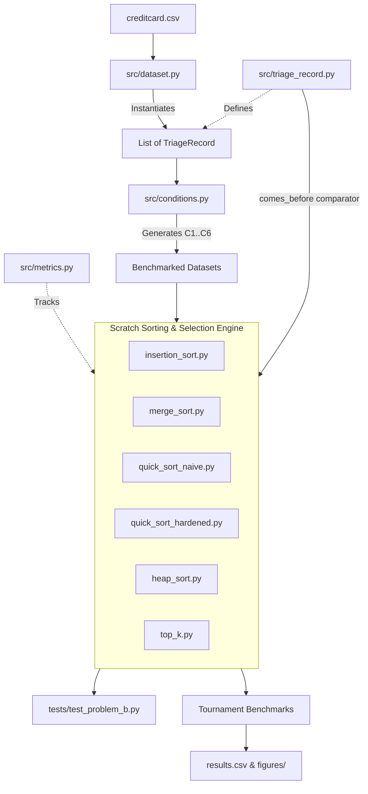

# The Midnight Queue: Ranking Suspicious Transactions at Scale

> **Course:** Design and Analysis of Algorithms | BS Data Science & Artificial Intelligence  
> **Institution:** National University of Computer and Emerging Sciences (FAST-NUCES), Islamabad Campus  
> **Student Parameters:** Roll Number Seed $s = 2514$, Shift Capacity $K = 25 + (2514 \pmod{226}) = 53$  
> **Core Constraint:** All sorting and selection algorithms implemented **from scratch** using **clean, standard Python with minimal/no external libraries**.


## Running the simplified code

The application and tests use only Python's standard library. Run these commands from the project folder:

```bash
python -m unittest discover -s tests -v
python console.py
```

Open http://127.0.0.1:8050 for the console. Its page is in `console.html`; the Python server and queue calculation are in `console.py`. Both files are needed when copying the console.

The loader uses three CSV passes: calculate means, calculate population standard deviations, then calculate risk and create records. This is easier to trace, but loads more slowly than the previous NumPy/pandas version. Loading is excluded from algorithm benchmarks.

The notebooks use ordinary loops and named functions for their Python logic. NumPy, pandas, Matplotlib, and seaborn remain in the data analysis/plotting notebook; Matplotlib remains in the benchmark notebooks. Install those packages and Jupyter separately to run the notebooks.

The bounded buffer now shifts items explicitly rather than calling `list.insert`. Its comparisons and counted moves are preserved, but runtime can change. Existing `results.csv`, figures, reports, and PDFs contain historical measurements. Notebook outputs were cleared; rerun the notebooks before using new timings in a submission. ZIP archives have been removed.

The EDA notebook now uses population standard deviation (`ddof=0`), matching the loader. Previously it used pandas' default sample standard deviation.

Read the code in this order: `triage_record.py`, `metrics.py`, `dataset.py`, `conditions.py`, the algorithm files, then `console.py` and the notebooks. Comments explain the purpose of each main step.


---

## 📖 1. Project Overview & Problem Statement

A payments processor handles over 284,000 credit card transactions over a 48-hour period. Human fraud analysts can inspect only **$K$ transactions per shift** ($K = 53$). Transactions ranked below position $K$ are never reviewed.

To maximize fraud detection, transactions must be ordered by a multi-tier **strict total order key**:
$$\textbf{band} \downarrow \;\longrightarrow\; \textbf{Amount} \downarrow \;\longrightarrow\; \textbf{Time} \uparrow \;\longrightarrow\; \textbf{txn\_id} \uparrow$$

1. **`band` (Descending):** Highest risk band (9 down to 0) comes first.
2. **`Amount` (Descending):** Larger transaction values prioritized within identical bands.
3. **`Time` (Ascending):** Earlier transaction timestamps prioritized on equal amounts.
4. **`txn_id` (Ascending):** Unique 1-indexed row number guarantees a total order with zero ties.

The goal of this project is to build, benchmark, analyze, and mathematically defend sorting algorithms under various real-world data conditions.

---

## 🧱 2. Design Philosophy: Simple Python & Zero External Sorting Libraries

- **Clean, Elementary Python:** Code is written with straightforward loops (`for`, `while`), basic lists, and elementary classes. No obscure syntax, no metaclasses, no complex decorators, and no third-party sorting/heap libraries (`heapq`, `scipy`, etc.).
- **Viva-Defensible:** Every algorithm is intuitive and easy to trace line-by-line during live code examinations.
- **Strictly Grounded Instrumentation:** Key comparisons and element moves are accurately counted through transparent, shared metric counters.

---

## 🗂️ 3. Project Structure & File Guide

```
the-midnight-queue/
│
├── README.md                           # Master architectural guide and documentation
├── TODO.md                             # Phased execution checklist and problem roadmap
├── .env                                # Personal configuration (ROLL_NUMBER=2514)
├── .gitignore                          # Excludes raw datasets, caches, and report files
│
├── src/                                # Core source code
│   ├── __init__.py                     # Package initializer
│   ├── metrics.py                      # Simple operation counter (comparisons, moves, time)
│   ├── triage_record.py                # Transaction record model and total order comparator
│   ├── dataset.py                      # CSV loader and standardized feature calculator
│   ├── conditions.py                   # Generator for Section 3.4 input conditions (C1 to C6)
│   │
│   └── algorithms/                     # Scratch-built sorting & selection contenders
│       ├── __init__.py                 # Algorithm package initializer
│       ├── insertion_sort.py           # In-place Insertion Sort
│       ├── merge_sort.py               # Out-of-place Merge Sort with aux buffer
│       ├── quick_sort_naive.py         # Lomuto QuickSort (last element pivot)
│       ├── quick_sort_hardened.py      # Hardened QuickSort (Median-of-3 + 3-way partition)
│       ├── heap_sort.py                # In-place Heap Sort (Floyd's bottom-up build)
│       └── top_k.py                    # Size-K Min-Heap and Bounded Insertion Buffer
│
├── tests/                              # Automated correctness verification suite
│   ├── __init__.py
│   └── test_problem_b.py               # unit tests with algorithm and condition subtests covering edge cases & conditions
│
├── figures/                            # Output visual plots and tournament charts
└── mlg-ulb/                            # Kaggle credit card dataset directory (git-ignored)
```

---

### Detailed File Breakdown

#### `src/metrics.py`
* **Purpose:** Provides a lightweight, non-library class `Metrics` to track algorithmic effort.
* **Fields:**
  * `comparisons`: Incremented on each pairwise key comparison.
  * `moves`: Incremented on each element write, shift, or array slot assignment (swaps count as 2 moves; self-swaps count as 0).
  * `elapsed_time`: Wall-clock seconds measured via `time.perf_counter()`.
  * `peak_extra_memory`: Maximum number of auxiliary list elements allocated.
  * `dnf`: Boolean flag set to `True` if execution exceeds 5 minutes (300 seconds).

#### `src/triage_record.py`
* **Purpose:** Defines the data structure representing a transaction and the total-order comparison logic.
* **Class `TriageRecord`:** Holds `txn_id`, `Time`, `Amount`, `risk`, `band`, and `Class`.
  * Provides `triage_key()` returning `(-band, -Amount, Time, txn_id)` for oracle comparison.
* **Function `comes_before(a, b, metrics, band_only)`:**
  * Returns `True` if record `a` ranks before record `b` in triage order.
  * Automatically increments `metrics.comparisons`.
  * Supports `band_only=True` for Condition C6.

#### `src/dataset.py`
* **Purpose:** Ingests `creditcard.csv` and computes Section 3.2 standardized features:
  1. Assigns `txn_id` from 1 to $N$.
  2. Standardizes features $V_1 \dots V_{28}$: $z_i = \frac{V_i - \mu_i}{\sigma_i}$.
  3. Computes risk score: $\text{risk} = \sum_{i=1}^{28} z_i^2$.
  4. Computes discrete risk band: $\text{band} = \min(9, \max(0, \lfloor \log_2(\text{risk}) \rfloor))$.
* **Output:** Returns a list of `TriageRecord` objects.

#### `src/conditions.py`
* **Purpose:** Implements Section 3.3 & 3.4 input conditions using random seed $s = 2514$:
  * **C1 (Arrival):** File order (`Time` ascending).
  * **C2 (Shuffled):** Uniformly shuffled order with seed $s$.
  * **C3 (Pre-ranked):** Already sorted in complete triage order.
  * **C4 (Reverse-ranked):** Exact reverse of triage order.
  * **C5 (Nearly ranked):** C3 with 1% of elements displaced to random positions.
  * **C6 (Band-only):** C1 arrival order sorted solely by `band` (massive duplicate ties).
  * Includes `subsample_records(records, n, seed)` to extract uniform subsamples restored to `Time` order.

---

### Algorithm Contenders (`src/algorithms/`)

#### 1. `src/algorithms/insertion_sort.py`
* **Mechanics:** Iterates through list, picks element, shifts larger elements to the right, and inserts in place.
* **Complexity:** Best $O(n)$, Worst $O(n^2)$, Average $O(n + I)$ where $I$ is inversions.
* **Characteristics:** In-place ($O(1)$ memory), strictly stable.

#### 2. `src/algorithms/merge_sort.py`
* **Mechanics:** Divides list into two halves, recursively sorts each half, and merges them using a single preallocated auxiliary buffer `aux`.
* **Complexity:** Guaranteed $O(n \log n)$ across all conditions; requires $O(n)$ extra memory.
* **Characteristics:** Out-of-place, strictly stable (left element chosen on equal keys).

#### 3. `src/algorithms/quick_sort_naive.py`
* **Mechanics:** Classic Lomuto partitioning scheme using the last element as pivot.
* **Crash Handling:** On sorted data (C3/C4), recursion depth reaches $n$, causing Python's `RecursionError` for $n \ge 1,000$. The file includes both the native recursive call (which documents the crash) and an explicit list-based stack (allowing it to run up to the 5-minute DNF limit).
* **Complexity:** Best/Average $O(n \log n)$, Worst $O(n^2)$.

#### 4. `src/algorithms/quick_sort_hardened.py`
* **Mechanics:** Production-grade hardened variant combining:
  1. **Median-of-Three:** Pivot is the median of `arr[low]`, `arr[mid]`, `arr[high]`, defeating C3, C4, and C5.
  2. **3-Way Dutch National Flag Partitioning:** Splits into $< \text{pivot}$, $= \text{pivot}$, and $> \text{pivot}$. Runs in $O(n)$ time on duplicate-heavy data (C6).
  3. **Tail-Recursion Loop:** Recurses on smaller partition first, guaranteeing maximum call stack depth $\le O(\log n) \approx 19$ frames.

#### 5. `src/algorithms/heap_sort.py`
* **Mechanics:**
  1. Bottom-up Floyd build-heap in $O(n)$ time.
  2. Repeatedly swaps root with end of array and calls sift-down in $O(n \log n)$ time.
* **Triage Order Handling:** To place the highest-priority element at `arr[0]` without reversing, the heap root holds the element with the *lowest* triage priority.
* **Complexity:** Guaranteed $O(n \log n)$ time; strictly in-place ($O(1)$ memory); unstable.

#### 6. `src/algorithms/top_k.py`
* **Contender A: Size-K Min-Heap (`top_k_min_heap`):**
  * Maintains a min-heap of capacity $K$ where root is the weakest survivor among the top $K$.
  * Discards non-qualifying elements in 1 comparison; qualifying elements sift-down in $O(\log K)$.
  * Total time: $O(n \log K)$, auxiliary space: $O(K)$.
* **Contender B: Bounded Insertion Buffer (`top_k_bounded_buffer`):**
  * Maintains a sorted list of capacity $K$.
  * Tests incoming items against the worst item (`buf[-1]`) in 1 comparison.
  * Discards worst and inserts new item using binary search insertion.
  * Total time: $O(n)$ best case, $O(n \cdot K)$ worst case, auxiliary space: $O(K)$.

---

## 🔄 4. Inter-File Relationships & Architecture Flow

The diagram below illustrates how data and control flow through the system:



### Module Dependencies:
1. **`src/triage_record.py`** is the core dependency for all algorithms, condition generators, and tests.
2. **`src/metrics.py`** is passed into all algorithms to instrument comparisons, moves, and memory without altering sorting behavior.
3. **`src/conditions.py`** transforms `TriageRecord` lists into conditions C1–C6 using personal seed $s = 2514$.
4. **`tests/test_problem_b.py`** imports all algorithms and compares their outputs against Python's built-in `sorted(..., key=r.triage_key())` oracle.

---

## 🧪 5. How to Run Tests & Verify Correctness

The project includes an automated test suite verifying edge cases, stability, total order correctness, and crash recovery.

Run the test suite using standard Python:
```bash
python -m unittest tests.test_problem_b -v
```

### Verification Matrix Covered in Tests:
- [x] **Empty Input (`n = 0`):** All contenders return `[]` without error.
- [x] **Single Record (`n = 1`):** All contenders return `[rec]`.
- [x] **All-Equal Keys:** Verified across all contenders.
- [x] **Duplicate-Heavy Keys:** Verified for condition C6 band-only.
- [x] **Total Order Identity:** Outputs must be 100% bit-for-bit identical to Python's `sorted()` oracle.
- [x] **Top-$K$ Accuracy:** Both Min-Heap and Bounded Buffer outputs match `oracle[:K]`.
- [x] **Conditions C1–C6:** Tested on sampled datasets.
- [x] **Naive QuickSort Recursion Handling:** Proves that native recursion crashes with `RecursionError` on sorted inputs of size $1,200$, while the iterative stack completes safely.
- [x] **Analyst Console Endpoints:** Automated test suite in `tests/test_console.py` verifies web serving, JSON API, and Problem G rules.

---

## 🚀 6. How to Reproduce All Deliverables

### A. Run Full Test Suite
```bash
python -m unittest discover -s tests -v
```

### B. Launch The Analyst Console (Bonus Deliverable — Section 6)
```bash
py console.py
# Open your browser at http://127.0.0.1:8050
```

### C. Jupyter Notebooks
- `stage_1_eda.ipynb`: Problem A Data Profiling & Empirical Verification.
- `stage_3_tournament.ipynb`: Problem C 30-Cell Algorithmic Tournament & Empirical Benchmarking.
- `stage_4_shift_queue.ipynb`: Problem D Shift Queue & Problem E Live Streaming Ingestion ($K=53$).

### D. Deliverable Reports & Artifacts
- `24i-2514-A2-A.pdf`: Final verified 5-page PDF report.
- `results.csv`: Empirical benchmark results for all 30 cells.
- `reports/`: Complete theoretical proofs (M1-M8), executive recommendations, Problem G change request, and viva defense guide.

---

## 📚 7. Master Documentation Directory (`reports/`)

- **[`reports/master_codebase_and_demo_guide.md`](file:///d:/the-midnight-queue/reports/master_codebase_and_demo_guide.md):** **Master Reading Order & Viva Defense Playbook** — 7-step reading sequence, 60-second live demo script, in-depth question bank with model answers, and live code modification drills.
- **[`reports/problem_f_mathematical_case.md`](file:///d:/the-midnight-queue/reports/problem_f_mathematical_case.md):** Complete mathematical derivations (M1 to M8) including recurrence unrolling, recursion trees, Master's Theorem, exact inversion count ($I = 262,763,679$), and Lomuto duplicate combinatorics.
- **[`reports/problem_h_recommendations.md`](file:///d:/the-midnight-queue/reports/problem_h_recommendations.md):** Executive Recommendations for the Platform Lead covering Overnight Batch, Shift Queue, and Live Streaming Refresh.
- **[`reports/problem_g_change_request.md`](file:///d:/the-midnight-queue/reports/problem_g_change_request.md):** Formal Problem G Addendum analyzing burst fraud mitigation (Freshest First CR-A vs. Continuous Risk CR-B), Algorithmic Impact Matrix, and fresh measurements.
- **[`reports/viva_defense_guide.md`](file:///d:/the-midnight-queue/reports/viva_defense_guide.md):** Oral examination prep guide, top 10 viva questions and model answers, and examiner live code modification drills.

