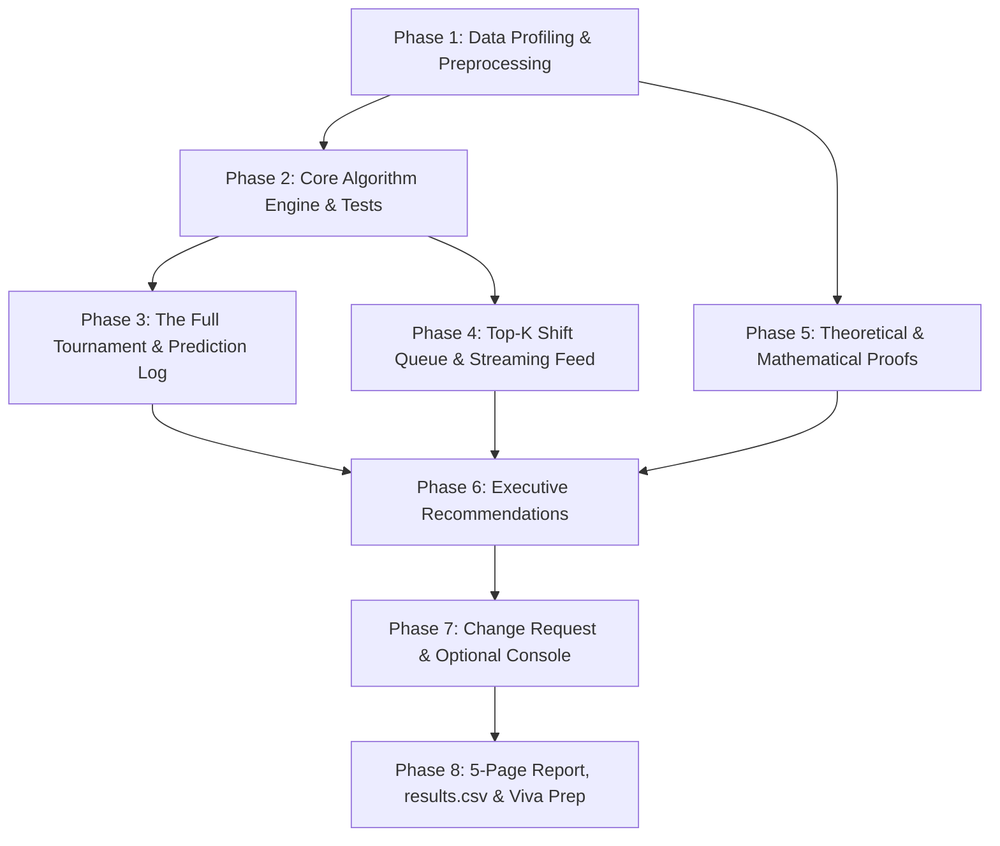

# The Midnight Queue: Assignment 2 Master TODO & Implementation Roadmap

> **Course:** Design and Analysis of Algorithms | BS Data Science & Artificial Intelligence  
> **Institution:** FAST NUCES Islamabad  
> **Weightage:** 100 Marks (+ 5 Bonus) | **Viva:** 20 Marks (Scores < 50% cap total grade at 60%)  
> **Report Constraint:** Typed PDF strictly maximum **5 pages** (Naming: `RollNo-A2-Section.pdf` / `RollNo-A2-Section.zip`)

---

## 📌 0. Personal Parameters & Project Setup

- [x] **Configure Roll Number Parameters**:
  - [x] Determine student roll number digits $s$: `s = 2514`
  - [x] Calculate personal shift capacity: $K = 25 + (2514 \pmod{226}) = 53$
  - [x] Configure global random seed: `seed = 2514` (for sampling, shuffling, and displacements)
- [x] **Data Pipeline Setup**:
  - [x] Acquire `creditcard.csv` (284,807 transactions) from Kaggle (ULB dataset)
  - [x] Ensure `creditcard.csv` is excluded from git and final zip package (`.gitignore`)
  - [x] Set up project structure (`src/`, `tests/`, `benchmarks/`, `figures/`, `reports/`)

---

## ⚖️ Ground Rules & Engineering Constraints

- [x] **No Built-in Sorts:** Implement all sorting algorithms from scratch (no `sort()`, `sorted()`, or `np.sort` within contenders; built-ins allowed only as baseline/oracle).
- [x] **Identical Inputs:** Every contender in every benchmark gets a fresh, identical deep copy of the input.
- [x] **Instrumentation Standards:** Standardize and document consistent definitions for:
  - **Key Comparisons:** Every pairwise comparison using the multi-tier triage key.
  - **Element Moves:** Every swap, assignment to auxiliary buffer, or displacement in-place.
- [x] **Benchmarking Standards:** Use `time.perf_counter()`; exclude file I/O and risk calculation; record median of independent runs.
- [x] **DNF Rule:** Any run exceeding 5 minutes (300s) is marked as `DNF`. Must extrapolate/predict using analytical complexity and smaller $n$.
- [x] **Triage Key (Total Order):**
  $$\text{band} \downarrow \;\longrightarrow\; \text{Amount} \downarrow \;\longrightarrow\; \text{Time} \uparrow \;\longrightarrow\; \text{txn\_id} \uparrow$$
- [x] **Evaluation Only:** `Class` is strictly used for fraud recall analysis; it must never be used in risk scoring or sorting keys.

---

## 📅 Phased Implementation Checklist

---

### Phase 1: Know Your Data (Problem A — 5 Marks)

- [x] **Compute Derived Features**:
  - [x] Assign 1-indexed `txn_id` based on original file row order.
  - [x] Calculate standardized features across all rows: $z_i = \frac{V_i - \mu_i}{\sigma_i}$ for $i \in \{1 \dots 28\}$.
  - [x] Calculate risk score: $\text{risk} = \sum_{i=1}^{28} z_i^2$.
  - [x] Assign risk band: $\text{band} = \min(9, \max(0, \lfloor \log_2(\text{risk}) \rfloor))$.
- [x] **Data Profiling Tasks**:
  - [x] Generate frequency table and histogram of `band` (0 to 9).
  - [x] Calculate distinct `Amount` values and compute percentage share held by top 10 most frequent amounts.
  - [x] Analyze fraud distribution: count of fraud cases per risk band.
  - [x] Evaluate raw file ordering properties against Section 3.4 (C1–C6) with empirical evidence (e.g., check if already strictly sorted by `Time`).

---

### Phase 2: Build the Contenders & Verification Suite (Problem B — 20 Marks)

- [x] **Core Algorithm Implementations (Instrumented with comparisons & moves)**:
  - [x] **Insertion Sort** (3 marks): In-place, optimized with counters.
  - [x] **Merge Sort** (4 marks): Out-of-place, tracking auxiliary allocation.
  - [x] **Quick Sort** (5 marks):
    - [x] *Naive Variant:* Lomuto partitioning using the last element as pivot.
    - [x] *Hardened Variant:* Median-of-three pivot, randomized pivot, or 3-way Dutch National Flag partition.
    - [x] *Safety Guard:* Mitigate recursion limit issues (tail recursion or iteration) on sorted inputs.
  - [x] **Heap Sort** (4 marks): In-place binary max-heap construction and extraction.
  - [x] **Top-K Selectors** (4 marks):
    - [x] *Size-$K$ Min-Heap:* Streaming priority queue keeping $K$ maximal triage elements.
    - [x] *Bounded Insertion Buffer of size $K$:* Maintained sorted array of capacity $K$.
- [x] **Correctness Test Suite**:
  - [x] Verify against ground truth `sorted()` on all 6 conditions and all sizes.
  - [x] Edge case testing:
    - [x] Empty input (`n = 0`)
    - [x] Single record (`n = 1`)
    - [x] All-equal keys
    - [x] Duplicate-heavy input (C6 band-only)
  - [x] Verify outputs are strictly identical (total order guarantee).

---

### Phase 3: The Full Ranking Tournament (Problem C — 10 Marks)

- [x] **Input Condition Generators**:
  - [x] **C1 (Arrival):** Natural file order (`Time` ascending).
  - [x] **C2 (Shuffled):** C1 uniformly shuffled with seed $s = 2514$.
  - [x] **C3 (Pre-ranked):** Already sorted in complete triage order.
  - [x] **C4 (Reverse-ranked):** Exact reverse of triage order.
  - [x] **C5 (Nearly ranked):** C3 with 1% of elements displaced to random positions.
  - [x] **C6 (Band-only):** C1 with sort key based strictly on `band`.
  - [x] Sizes: $n \in \{1,000; 10,000; 100,000; 284,807\}$.
- [x] **Prediction Log (Mandatory)**:
  - [x] Maintain a written log before each run: predict winner, loser, and theoretical reason.
  - [x] Post-run reflections: document what failed or differed from theoretical intuition.
- [x] **Benchmark Execution**:
  - [x] Run all 5 full-sort contenders on $6 \text{ conditions} \times 4 \text{ sizes}$.
  - [x] Compute median of runs using `time.perf_counter()`.
  - [x] Record DNF for any run $> 5\text{ min}$ and analytically extrapolate.
- [x] **Deliverable Charts & Tables**:
  - [x] Plot 1: Execution time vs. $n$ on C2 (log-log scale).
  - [x] Plot 2: Execution time across all 6 conditions at $n = 10,000$ (grouped bar chart).
  - [x] Plot 3: Comparisons and moves vs. $n$ on C2.
  - [x] Plot 4: Normalized growth curves: $\frac{T(n)}{n \log n}$ and $\frac{T(n)}{n^2}$ vs. $n$.
  - [x] Master Summary Table: Execution time, comparisons, moves, auxiliary memory, and stability for each contender.
  - [x] Full export to `results.csv`.

---

### Phase 4: Shift Queue & Streaming Workloads (Problems D & E — 14 Marks)

- [x] **Problem D: The Shift Queue (Top-$K$ Analysis — 7 Marks)**:
  - [x] Contenders to compare:
    - (a) Full Sort $\to$ take first $K$
    - (b) Size-$K$ Min-Heap
    - (c) Bounded Insertion Buffer
  - [x] Benchmark configurations:
    - $K \in \{10, 50, K_{\text{personal}}=53, 500, 5000, n/10\}$
    - $n \in \{100,000; 284,807\}$
    - Conditions: C1 and C2
  - [x] Analysis:
    - [x] Determine empirical crossover points: where does each method stop being optimal?
    - [x] Plot fraction of all frauds captured in top $K$ as $K$ increases.
    - [x] Find smallest $K$ that captures $\ge 50\%$ of all frauds under this scoring rule ($K = 2{,}068$).
    - [x] Calculate the computational cost to produce that queue across all 3 methods.
- [x] **Problem E: The Live Feed (Continuous Ranking — 7 Marks)**:
  - [x] Split dataset chronologically into:
    - 1-hour windows (48 windows)
    - 10-minute windows (288 windows)
  - [x] Evaluate 3 incremental strategies to publish top $K$ seen so far:
    - Strategy (a): Re-rank everything seen so far from scratch.
    - Strategy (b): Maintain a size-$K$ heap fed only by incoming window records.
    - Strategy (c): Merge Sort the new window, then merge into current top-$K$ list.
  - [x] Plot cumulative runtime vs. window index for 1-hour and 10-minute windows.
  - [x] Monitor and report peak auxiliary memory footprint for each strategy.

---

### Phase 5: Theoretical Foundations & Proofs (Problem F — 22 Marks)

- [x] **M1 — Insertion Sort (3 Marks):**
  - [x] Direct analysis of best, average, and worst-case running times.
  - [x] Express running time in terms of $n$ and inversion count $I$.
  - [x] Measure exact inversion count $I$ on the personal C5 sample ($I = 262{,}763{,}679$ on full dataset).
- [x] **M2 — Merge Sort (3 Marks):**
  - [x] Solve recurrence $T(n) = 2T(n/2) + \Theta(n)$ using iteration (unrolling).
  - [x] Formally verify solution using Master's Theorem.
- [x] **M3 — Quick Sort (4 Marks):**
  - [x] (a) Worst case: $T(n) = T(n-1) + \Theta(n)$ by iteration.
  - [x] (b) Best case: $T(n) = 2T(n/2) + \Theta(n)$ by recursion tree.
  - [x] (c) 1:9 Unbalanced split: $T(n) = T(n/10) + T(9n/10) + n$ by recursion tree; derive tight bound $\Theta(n \log n)$.
- [x] **M4 — Heap Sort (3 Marks):**
  - [x] Justify $O(n)$ build-heap cost: $\sum_{h=0}^{\lfloor \log n \rfloor} \lceil \frac{n}{2^{h+1}} \rceil O(h) = O(n)$.
  - [x] Justify total $O(n \log n)$ cost.
- [x] **M5 — Top-$K$ Complexity & Crossover (3 Marks):**
  - [x] Derive asymptotic costs of methods (a), (b), and (c) from Problem D in terms of $n$ and $K$.
  - [x] Predict analytical crossover $K$ for $n = 100,000$ and compare with experimental data.
- [x] **M6 — Naive QuickSort on C6 (3 Marks):**
  - [x] Derive exact comparison count for band groups of sizes $m_1 \dots m_d$.
  - [x] Calculate predicted comparisons from actual dataset band group sizes.
  - [x] Compare theoretical prediction against measured comparison count.
- [x] **M7 — Live Feed Asymptotics (2 Marks):**
  - [x] Derive total cost over $w$ windows in terms of $n, w, K$ for strategies (a), (b), and (c).
  - [x] Determine conditions where the optimal strategy shifts.
- [x] **M8 — Space Complexity (1 Mark):**
  - [x] Provide explicit space complexity analysis (in-place vs. auxiliary) for every contender.

---

### Phase 6: Executive Recommendations (Problem H — 5 Marks)

Write concise, engineering-grade recommendations for the platform lead covering 3 distinct operational jobs:
- [x] **Job 1: Overnight Batch (Full-day batch ranking)**:
  - [x] Specify chosen algorithm (Merge Sort).
  - [x] Defend with experimental timing/memory data and mathematical bounds ($3.77\text{ s}$, $O(n \log n)$, stable).
  - [x] State core operating assumptions ($10\text{ MB}$ memory margin).
  - [x] State precise edge case or scenario where this choice breaks (Zero-memory embedded OOM $\to$ Heap Sort fallback).
- [x] **Job 2: Shift Queue (Real-time selection of top $K$ alerts)**:
  - [x] Specify chosen algorithm/data structure (Size-$K$ Min-Heap).
  - [x] Defend with empirical crossover data and fraud recall metrics ($35\times$ faster than Full Sort, $50\times$ fewer moves than Buffer).
  - [x] State core operating assumptions and failure condition ($K \ge 0.35 n \to$ Full Sort fallback).
- [x] **Job 3: Live Refresh (Streaming updates per window)**:
  - [x] Specify chosen streaming strategy (Strategy b: Persistent Streaming Min-Heap).
  - [x] Defend with cumulative latency and memory profile ($0.093\text{ s}$ total latency, $O(K) = 53$ elements memory).
  - [x] State core operating assumptions and failure condition (Dynamic rolling re-standardization $\to$ Strategy c fallback).

---

### Phase 7: Change Request & Optional Console (Problem G & Bonus — 9 Marks)

- [ ] **Problem G: Change Request (4 Marks)**:
  - [ ] Monitor portal 48 hours before deadline for Platform Lead change prompt.
  - [ ] Re-run affected benchmarks under updated constraints.
  - [ ] Draft short report addendum: identify what changed, valid vs. invalid prior conclusions, and updated data.
- [ ] **Bonus: Analyst Console (Optional — 5 Marks)**:
  - [ ] Build lightweight UI (Streamlit, Flask/FastAPI, or Vanilla Web Interface).
  - [ ] Interactive controls: select sorting algorithm, adjust $K$ slider.
  - [ ] Interactive display: table of top $K$ transactions (`band`, `Amount`, `Time`, `txn_id`).
  - [ ] Performance metrics display: elapsed execution time and total key comparisons.
  - [ ] Include 1-paragraph summary in report and prepare for viva demo.

---

### Phase 8: Deliverables Packaging & Viva Defense Prep

- [ ] **PDF Report Generation (`RollNo-A2-Section.pdf`)**:
  - [ ] Strictly adhere to **$\le 5$ pages limit** for body (Problems A–H + Addendum + AI disclosure).
  - [ ] Append Prediction Log as appendix.
  - [ ] Ensure all plots have labeled axes with units, complete legends, and descriptive captions.
  - [ ] Include 1-paragraph mandatory AI Use Disclosure.
- [ ] **Data Export**:
  - [ ] Generate comprehensive `results.csv` containing all measurement runs.
- [ ] **Code Archive (`RollNo-A2-Section.zip`)**:
  - [ ] Clean code structure with test suite and reproduction script (`README.md`).
  - [ ] Ensure no dataset (`creditcard.csv`) or temporary caches are zipped.
- [ ] **Viva Defense Preparation (20 Marks)**:
  - [ ] Practice explaining code mechanics and modifying algorithms live on unseen inputs.
  - [ ] Prepare mathematical justification for every anomaly or clash between theory and measurement.
