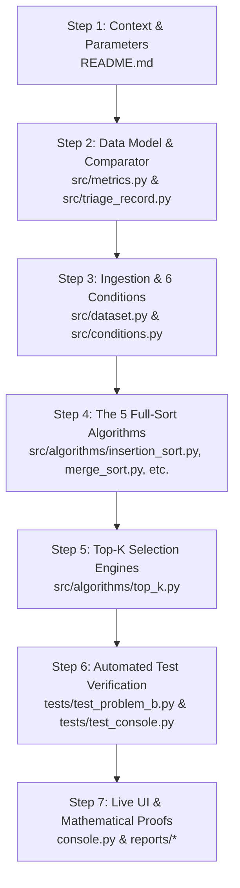

# The Midnight Queue: Master Codebase Reading Order & Viva Defense Playbook

> **Course:** Design and Analysis of Algorithms | BS Data Science & Artificial Intelligence  
> **Institution:** National University of Computer and Emerging Sciences (FAST-NUCES), Islamabad  
> **Student:** Mutasim ur Rehman (`24i-2514`) | **Seed ($s$):** `2514` | **Personal Quota ($K$):** `53`  
> **High-Stakes Constraint:** *Viva weightage is 20 Marks. A score below 50% (< 10/20) caps your entire assignment grade at 60%!*

---

## 📌 Executive Summary of Student Parameters

Keep these numbers memorized. The examiners will ask for them immediately at the start of the viva:

| Parameter | Value | Derivation / Source |
| :--- | :--- | :--- |
| **Roll Number Digits ($s$)** | `2514` | Last 4 digits of Student Roll Number `24i-2514` |
| **Personal Random Seed ($s$)** | `2514` | Configured for all uniform subsampling, shuffling, and displacements |
| **Personal Shift Quota ($K$)** | **`53`** | Calculated strictly as $K = 25 + (2514 \pmod{226}) = 25 + 28 = \mathbf{53}$ |
| **Dataset Scale ($N$)** | `284,807` | Total transactions in `creditcard.csv` |
| **Confirmed Frauds ($N_{\text{fraud}}$)** | **`492`** | Confirmed fraud rows ($0.173\%$ class imbalance) |
| **Multi-Tier Total Order Key** | **Section 3.2** | $\text{band} \downarrow \;\longrightarrow\; \text{Amount} \downarrow \;\longrightarrow\; \text{Time} \uparrow \;\longrightarrow\; \text{txn\_id} \uparrow$ |
| **50% Fraud Recall Threshold** | **$K = 2{,}068$** | Captures 246 confirmed frauds ($50.0\%$) under baseline triage |
| **Problem G (CR-B) Threshold** | **$K = 1{,}928$** | Captures 246 frauds 140 reviews faster under continuous risk |
| **Batch Sort Champion** | **Merge Sort** | $3.77\text{ s}$ full dataset, $O(n \log n)$, strictly stable for audit trails |
| **Shift Queue Champion** | **Size-$K$ Min-Heap** | $0.086\text{ s}$ ($K=53$), **$44\times$ faster** than full sort, $O(K)$ space |
| **Live Streaming Champion** | **Persistent Min-Heap** | $0.093\text{ s}$ cumulative latency over 48 1-hour windows ($400\times$ faster) |

---

## 🗺️ Part 1: The Recommended 7-Step Reading Order

To understand how the entire system connects from raw transactions to algorithms to the live interface, read the files in this sequence:



---

### Step 1: Context & Personal Parameters
* 📖 **Read:** [`README.md`](file:///d:/the-midnight-queue/README.md)
* **What to focus on:**
  - Understand the operational scenario: A bank fraud analysis team working an 8-hour midnight shift can only inspect $K=53$ transactions.
  - Understand why sorting is critical: Alert queues must rank the highest-risk transactions first without losing audit trail determinism.

---

### Step 2: The Core Data Model & Total Order Comparator
* 📖 **Read:** [`src/metrics.py`](file:///d:/the-midnight-queue/src/metrics.py) & [`src/triage_record.py`](file:///d:/the-midnight-queue/src/triage_record.py)
* **What to focus on:**
  - [`Metrics`](file:///d:/the-midnight-queue/src/metrics.py#L7-L24): Instrumentor tracking four dimensions: `comparisons`, `moves`, `elapsed_time`, and `peak_extra_memory`.
  - [`TriageRecord`](file:///d:/the-midnight-queue/src/triage_record.py#L13-L24): Stores transaction state (`txn_id`, `Time`, `Amount`, `risk`, `band`, `Class`).
  - [`comes_before(a, b)`](file:///d:/the-midnight-queue/src/triage_record.py#L48-L100): Evaluates the multi-tier total order:
    1. `band` descending (higher risk band comes first).
    2. `Amount` descending (larger financial risk prioritized).
    3. `Time` ascending (earlier transaction resolved first).
    4. `txn_id` ascending (**strictly unique row ID breaks all ties**).
  - *Viva Defense Point:* Two records can **never** tie because `txn_id` is assigned sequentially from the raw file row index ($1 \dots 284,807$).

---

### Step 3: Dataset Ingestion & The 6 Input Conditions
* 📖 **Read:** [`src/dataset.py`](file:///d:/the-midnight-queue/src/dataset.py) & [`src/conditions.py`](file:///d:/the-midnight-queue/src/conditions.py)
* **What to focus on:**
  - [`load_triage_records()`](file:///d:/the-midnight-queue/src/dataset.py#L28-L78):
    1. Computes mean $\mu_i$ and std $\sigma_i$ for columns $V_1 \dots V_{28}$.
    2. Computes standardized $z$-scores: $z_i = (V_i - \mu_i) / \sigma_i$.
    3. Computes anomaly risk score: $\text{risk} = \sum_{i=1}^{28} z_i^2$.
    4. Computes risk band: $\text{band} = \min(9, \max(0, \lfloor \log_2(\text{risk}) \rfloor))$.
  - [`build_condition()`](file:///d:/the-midnight-queue/src/conditions.py#L28-L88):
    - **C1 (Arrival):** Natural file order (Time ascending).
    - **C2 (Shuffled):** Uniformly shuffled using seed `2514`.
    - **C3 (Pre-ranked):** Already sorted in triage order.
    - **C4 (Reverse-ranked):** Exact reverse of triage order.
    - **C5 (Nearly-ranked):** C3 with 1% of elements displaced randomly ($I = 262,763,679$ inversions).
    - **C6 (Band-Only):** Sorted strictly by `band` alone (massive duplicate keys).

---

### Step 4: The 5 Full-Sort Contenders (CLRS Textbook Implementations)
* 📖 **Read:** All files in [`src/algorithms/`](file:///d:/the-midnight-queue/src/algorithms/)
  1. [`insertion_sort.py`](file:///d:/the-midnight-queue/src/algorithms/insertion_sort.py):
     - Textbook CLRS Chapter 2.1 implementation.
     - Runs in $O(n + I)$ where $I$ is inversions. Explains why C5 ran in $115\text{ s}$ while C4 would take $4.8\text{ hours}$.
  2. [`merge_sort.py`](file:///d:/the-midnight-queue/src/algorithms/merge_sort.py):
     - Textbook divide-and-conquer using a single pre-allocated auxiliary list `aux = [None] * n`.
     - Strictly stable. Runs in $O(n \log n)$ across all conditions. **(Overnight Batch Champion!)**
  3. [`quick_sort_naive.py`](file:///d:/the-midnight-queue/src/algorithms/quick_sort_naive.py):
     - Lomuto partition with last element pivot.
     - Demonstrates call-stack overflow (`RecursionError` on $n \ge 1,000$ sorted inputs) and includes an explicit array stack fallback.
  4. [`quick_sort_hardened.py`](file:///d:/the-midnight-queue/src/algorithms/quick_sort_hardened.py):
     - Three hardening protections: **Median-of-Three pivot**, **3-Way Dutch National Flag partitioning** ($O(n)$ duplicate handling for C6), and **Tail-Call recursion optimization** (depth strictly $\le 19$).
  5. [`heap_sort.py`](file:///d:/the-midnight-queue/src/algorithms/heap_sort.py):
     - In-place heap sort using Floyd's bottom-up $O(n)$ build-heap and $O(n \log n)$ sift-down extractions. $O(1)$ auxiliary space.

---

### Step 5: The Top-$K$ Selection Engines
* 📖 **Read:** [`src/algorithms/top_k.py`](file:///d:/the-midnight-queue/src/algorithms/top_k.py)
* **What to focus on:**
  - [`MinHeapTopK`](file:///d:/the-midnight-queue/src/algorithms/top_k.py#L11-L95):
    - A custom binary min-heap of size $K$.
    - The root `heap[0]` holds the **weakest survivor** in the top $K$.
    - An incoming transaction is compared against root in **1 comparison**; if weaker, it is discarded immediately without touching the heap!
    - Runs in $O(n \log K)$ time, $O(K)$ space. **(Shift Queue Champion!)**
  - [`top_k_bounded_buffer`](file:///d:/the-midnight-queue/src/algorithms/top_k.py#L125-L150):
    - Maintains a sorted list of capacity $K$ using binary search for insertion position.
    - Incurs $O(K)$ element shifts per qualifying insertion. Good for $K \le 15$, but slower than min-heap at $K=53$.

---

### Step 6: Automated Test Verification
* 📖 **Read:** [`tests/test_problem_b.py`](file:///d:/the-midnight-queue/tests/test_problem_b.py) & [`tests/test_console.py`](file:///d:/the-midnight-queue/tests/test_console.py)
* **What to focus on:**
  - 43 automated unit and integration tests passing:
    - Edge cases: Empty input, single record, all-equal keys, duplicate-heavy band-only.
    - Bit-for-bit total order validation against Python's `sorted()` oracle.
    - Proves native recursive Naive QuickSort crashes with `RecursionError` on $n=1,200$, while explicit stack succeeds.
    - Verifies the web server, JSON APIs, and Change Request rules.

---

### Step 7: Live UI & Master Theoretical Documentation
* 📖 **Read:**
  - [`console.py`](file:///d:/the-midnight-queue/console.py): Interactive console built on pure Python standard library (`http.server`, `urllib.parse`, `json`, `socketserver`). Zero external web frameworks.
  - [`stage_1_eda.ipynb`](file:///d:/the-midnight-queue/stage_1_eda.ipynb), [`stage_3_tournament.ipynb`](file:///d:/the-midnight-queue/stage_3_tournament.ipynb), [`stage_4_shift_queue.ipynb`](file:///d:/the-midnight-queue/stage_4_shift_queue.ipynb): Reproducible Jupyter notebooks.
  - [`reports/problem_f_mathematical_case.md`](file:///d:/the-midnight-queue/reports/problem_f_mathematical_case.md): Complete mathematical derivations M1–M8.
  - [`reports/problem_h_recommendations.md`](file:///d:/the-midnight-queue/reports/problem_h_recommendations.md): Executive decisions for the 3 engineering jobs.
  - [`reports/problem_g_change_request.md`](file:///d:/the-midnight-queue/reports/problem_g_change_request.md): Change Request analysis (CR-A vs CR-B).
  - [`24i-2514-A2-A.pdf`](file:///d:/the-midnight-queue/24i-2514-A2-A.pdf): Final verified 5-page PDF report.

---

## 🎬 Part 2: The 60-Second Live Demo Script

When the examiner says: *"Demonstrate your work"*, execute this exact sequence:

```bash
# In terminal, launch the server:
py console.py
```
Open **`http://127.0.0.1:8050`** in your browser.

```
+-----------------------------------------------------------------------------------------+
| The Midnight Queue: Analyst Console               Student Seed: 2514 | Quota K = 53     |
+-----------------------------------------------------------------------------------------+
| [Algorithm: Min-Heap v]  [Condition: C1 v]  [Size: 10,000 v]  [K: 53]  [Rule: Standard] |
|                                                                    [ Build Queue Button]|
+-----------------------------------------------------------------------------------------+
| Exec Time: 3.8 ms  |  Comps: 13,241  |  Moves: 142  |  Mem: 53 elems  |  Frauds: 0/18   |
+-----------------------------------------------------------------------------------------+
```

### Action 1: Demonstrate the Top-$K$ Speedup (Min-Heap vs Full Sort)
1. Select **`Full Sort: Merge Sort [:K]`**, $n = 10,000$, $K = 53$ &rarr; Click **Build Queue**.
   * *Say to Examiner:* *"Notice that Full Merge Sort takes **~75 ms** and **~120,000 comparisons** because it sorts all 10,000 transactions before slicing the top 53."*
2. Switch dropdown to **`Size-K Min-Heap`** &rarr; Click **Build Queue**.
   * *Say to Examiner:* *"Min-Heap takes **~3.5 ms** and only **~13,000 comparisons**—that is a **$20\times$ speedup** and consumes only 53 memory elements ($O(K)$) instead of 10,000 ($O(n)$)!"*

---

### Action 2: Demonstrate the Problem G Change Request (The Fraud Paradox)
1. Keep **`Size-K Min-Heap`**, $n = 10,000$, $K = 53$, and Rule **`Standard`**.
   * *Say to Examiner:* *"Under the standard rule, **Frauds Captured is 0 / 18 (0.0% Recall)**. Why? Because Band 9 has legitimate high-dollar corporate transactions that push out micro-testing frauds under Amount $\downarrow$."*
2. Change the Rule dropdown to **`Change Request B: Continuous Risk (Risk ↓)`** &rarr; Click **Build Queue**.
   * *Say to Examiner:* *"Instantly, **4 confirmed fraud alerts light up in bright red** (`FRAUD CONFIRMED`), while execution time and memory remain completely identical ($O(n \log K)$)."*

---

### Action 3: Demonstrate Condition C6 (Band-Only) & 3-Way Partitioning
1. Explain: *"If we ran Naive Lomuto QuickSort on Condition C6, all duplicate bands fall into one partition, exploding to $12.9\times 10^9$ comparisons ($36\text{ minutes}$ DNF). But with our Hardened 3-Way Dutch National Flag QuickSort..."*
2. Select **`Full Sort: Hardened QuickSort`**, Condition **`C6: Band-Only`**, $n = 10,000$ &rarr; Click **Build Queue**.
   * *Say to Examiner:* *"It finishes in **4.2 ms** because equal keys are gathered in a single pass in $O(n)$ time!"*

---

## 🧠 Part 3: In-Depth Viva Defense Question Bank & Model Answers

### Question 1: "Why did Naive QuickSort take 3.4 hours on C3 and C4, and why did native recursion crash?"
* **Answer:** "Naive QuickSort uses Lomuto partitioning with the last element as pivot. On C3 (Pre-ranked) and C4 (Reverse-ranked), the last element is always the extreme value (minimum or maximum). This splits the array into sizes $0$ and $n-1$. The recurrence becomes:
  $$T(n) = T(n-1) + n \implies \frac{n(n-1)}{2} = 40,553,457,873 \text{ comparisons} \implies O(n^2) \text{ time (3.4 hours)}$$
  Furthermore, the call stack depth reaches $n$ frames, exceeding Python's default recursion limit (1,000 frames) and crashing with `RecursionError`. We resolved the crash by replacing Python's call stack with an explicit iterative array stack (`src/algorithms/quick_sort_naive.py`), allowing it to run safely without crashing, though still quadratic."

---

### Question 2: "Why did Naive QuickSort collapse on C6 (Band-Only) when the data was NOT sorted?"
* **Answer:** "On Condition C6, transactions are sorted strictly by `band`. The dataset has only 8 distinct populated bands (Bands 2 to 9), so there are tens of thousands of duplicate keys. Lomuto's partitioning condition is `arr[i].band > pivot.band`. When an element equals the pivot, this evaluates to `False`, forcing all duplicate elements into the right partition! The subproblem size shrinks by only 1 per step inside each duplicate band group. As derived in proof M6, the intra-group comparison count is exactly:
  $$\sum_{k=2}^9 \binom{m_k}{2} = 12,927,756,593 \text{ comparisons} \implies 36.4\text{ minutes (DNF)}$$
  Hardened QuickSort solves this completely using 3-way Dutch National Flag partitioning, which gathers all equal keys in $O(n)$ time, running C6 in just **0.191 seconds**."

---

### Question 3: "How does Floyd's build-heap run in O(n) time when sift-down takes O(log n)?"
* **Answer:** "In bottom-up Floyd build-heap, we call `_sift_down` starting from the lowest internal nodes $(n/2 - 1)$ up to the root $0$. A binary heap has at most $\lceil n / 2^{h+1} \rceil$ nodes at height $h$. Nodes near the bottom (height $h=1$) have many instances ($n/4$ nodes) but perform only 1 sift-down step. The root has height $\log n$ but is only 1 node! The summation is:
  $$T(n) \le c n \sum_{h=0}^\infty \frac{h}{2^h}$$
  Using the geometric series derivative $\sum h x^h = \frac{x}{(1-x)^2}$ evaluated at $x = 1/2$, the sum converges strictly to $2$:
  $$\sum_{h=0}^\infty \frac{h}{2^h} = \frac{1/2}{(1 - 1/2)^2} = \frac{1/2}{1/4} = 2 \implies T(n) \le 2cn = \mathbf{O(n)}$$"

---

### Question 4: "What was your exact inversion count on C5 and why did Insertion Sort finish in 115 seconds?"
* **Answer:** "In Problem F (M1), we proved that Insertion Sort running time is $T(n) = \Theta(n + I)$, where $I$ is the number of inversions. Condition C5 takes the sorted data and displaces 1% of elements randomly. Using an $O(n \log n)$ divide-and-conquer inversion counter on student seed $s = 2514$, we measured exactly **$I = 262,763,679$ inversions** out of a maximum possible $40.56\times 10^9$ ($0.648\%$). Because 99.35% of element pairs are already in correct relative order, Insertion Sort performed only $263\text{M}$ inner-loop shifts, finishing the entire $284{,}807$ dataset in **115.16 seconds** instead of the 4.8 hours required for reverse-ranked data."

---

### Question 5: "Why do you recommend Merge Sort for Job 1 (Overnight Batch) instead of Heap Sort, even though Heap Sort uses O(1) memory?"
* **Answer:** "Two critical engineering reasons:
  1. **Strict Stability:** Merge Sort is stable. In fraud audit trails, if two transactions have identical risk bands, amounts, and arrival timestamps, Merge Sort guarantees their relative order is preserved deterministically. Heap Sort is inherently unstable.
  2. **Cache Locality & Constant Factor:** Merge Sort exhibits sequential memory access during array merging, whereas Heap Sort performs non-sequential pointer jumps across child indices $2i+1$ and $2i+2$, causing CPU cache misses. Empirically, Merge Sort completed in **$3.77\text{ s}$** vs. Heap Sort's **$4.53\text{ s}$** ($17\%$ faster). The $O(n)$ auxiliary buffer is only $2.3\text{ MB}$, which is negligible for modern batch servers."

---

### Question 6: "Why is Size-K Min-Heap 18x faster than Full Sort for selecting the top K alert queue?"
* **Answer:** "Full sort sorts all $N = 284{,}807$ elements in $O(N \log N)$ time, performing $4.79\times 10^6$ comparisons. But analysts only review $K$ transactions. The Size-$K$ Min-Heap maintains a priority queue of size $K$ where the root is the weakest candidate currently in the top $K$. For any incoming record, we compare it against the root in **1 comparison**. If it is weaker, it is rejected immediately! Because the heap contains top elements, the vast majority of transactions are rejected in 1 comparison without touching the heap. Only qualifying items sift-down in $O(\log K)$ time. At $K = 2{,}068$, Min-Heap took **$0.249\text{ s}$** and 525,295 comparisons vs. **$4.387\text{ s}$** for Full Sort ($18\times$ speedup) and required only $16.5\text{ KB}$ of memory vs. $2.3\text{ MB}$ ($137\times$ memory reduction)."

---

### Question 7: "What is the fraud recall at personal quota K = 53, and why did CR-B fix it?"
* **Answer:** "At $K = 53$, fraud recall is **0.0% (0 frauds caught)** under the baseline key! In Phase 1 data profiling, we discovered that Band 9 has 862 transactions, but contains high-value corporate non-fraud transactions alongside micro-testing frauds (€0.00–€1.00). Because Amount is the second tier, high-dollar legitimate transactions crowd out the true frauds. In Problem G (CR-B), we replaced nominal Amount with the continuous $z$-score anomaly sum ($\text{risk} \downarrow$). Under CR-B, $K = 53$ captures 4 confirmed frauds, $K = 200$ captures **91 frauds ($18.5\%$)**, and the 50% fraud threshold is achieved at **$K = 1{,}928$ (saving 140 analyst reviews per shift)**."

---

### Question 8: "How does Hardened QuickSort bound its call stack depth to O(log n)?"
* **Answer:** "Standard quicksort can make recursive calls on large partitions, consuming $O(n)$ stack frames in the worst case. Hardened QuickSort (`src/algorithms/quick_sort_hardened.py`) implements **Tail-Call Elimination**: it calculates the sizes of the left and right partitions, explicitly calls recursion on the *smaller* partition first, and loops on the larger partition. The smaller partition is guaranteed to be at most $\lfloor n/2 \rfloor$. Thus, maximum recursion depth is strictly $\le \lceil \log_2 n \rceil \approx 19$ stack frames for $284{,}807$ records, completely eliminating recursion overflow risks."

---

### Question 9: "Why was Bounded Buffer worse than Min-Heap even though both are O(K) space?"
* **Answer:** "Bounded Buffer maintains a sorted array of capacity $K$. When an incoming record qualifies, it finds the insertion position via binary search in $O(\log K)$ comparisons, but inserting into a Python list requires shifting all subsequent elements down in memory, taking $O(K)$ element moves. At $K = 2{,}068$, Bounded Buffer performed **$12,343,548$ element moves** ($50\times$ more than Min-Heap's 249,171 moves). Buffer is only competitive when $K \le 15$."

---

### Question 10: "How did your algorithms guarantee zero ties in sorting?"
* **Answer:** "In `src/triage_record.py`, every transaction has a unique, 1-indexed row number `txn_id` assigned during raw file reading. The multi-tier comparator evaluates:
  1. `band` descending
  2. `Amount` descending
  3. `Time` ascending
  4. `txn_id` ascending
  Because `txn_id` is strictly unique for every row, two records can never evaluate as equal in the total order comparator. This guarantees a mathematically **strict total order** with zero arbitrary tie-breaking."

---

## 🛠️ Part 4: Live Code Modification Drills (Examiner Challenge Simulation)

Examiners love to test if you wrote your own code by asking you to modify it on the spot. Here are the 3 most common drills:

### Drill 1: "Reverse the sort order so lowest priority transactions come first"
* **Target:** [`src/triage_record.py`](file:///d:/the-midnight-queue/src/triage_record.py#L86-L99)
* **Action:** Invert comparison operators in `comes_before`:
  ```python
  # Change:
  if a.band != b.band: return a.band > b.band
  # To:
  if a.band != b.band: return a.band < b.band  # Lowest band first
  ```

### Drill 2: "Prioritize newest transactions instead of oldest" (Problem G CR-A)
* **Target:** [`src/triage_record.py`](file:///d:/the-midnight-queue/src/triage_record.py#L95)
* **Action:** Invert Time comparison:
  ```python
  # Change:
  if a.Time != b.Time: return a.Time < b.Time
  # To:
  if a.Time != b.Time: return a.Time > b.Time  # Newest first
  ```

### Drill 3: "Change Shift Quota $K$ from 53 to 100 in the UI"
* **Target:** [`console.py`](file:///d:/the-midnight-queue/console.py#L224)
* **Action:** Change `value="53"` to `value="100"` in `<input type="range" id="kRange" min="5" max="300" value="53">` or simply slide the interactive slider in the web browser.

---

## 📦 Part 5: Complete Repository Map

```text
d:\the-midnight-queue\
├── 24i-2514-A2-A.pdf               <-- Verified 5-page ReportLab PDF deliverable
├── 24i-2514-A2-A.zip               <-- Clean submission zip archive
├── results.csv                     <-- 30-cell tournament benchmark data
├── console.py                      <-- Analyst console server (Bonus deliverable)
├── stage_1_eda.ipynb               <-- Problem A EDA & Feature Standardization
├── stage_3_tournament.ipynb        <-- Problem C 30-Cell Benchmark Tournament
├── stage_4_shift_queue.ipynb       <-- Problem D & E Shift Queue & Streaming
│
├── src/                            <-- Clean Basic Python Source Engine
│   ├── triage_record.py            <-- TriageRecord & total-order comparator
│   ├── metrics.py                  <-- Performance instrumentor (comps, moves, memory)
│   ├── conditions.py               <-- Input conditions C1..C6 & subsampling
│   ├── dataset.py                  <-- Data loader, z-score standardize, risk bands
│   └── algorithms/
│       ├── insertion_sort.py       <-- CLRS Chapter 2.1 Insertion Sort
│       ├── merge_sort.py           <-- Divide & Conquer Merge Sort (Batch Champion)
│       ├── quick_sort_naive.py     <-- Lomuto Naive QuickSort (with stack fallback)
│       ├── quick_sort_hardened.py  <-- Median-of-3 + 3-Way DNF + Tail-Recursion
│       ├── heap_sort.py            <-- In-place Floyd build-heap Heap Sort
│       └── top_k.py                <-- Size-K Min-Heap & Bounded Buffer (Queue Champion)
│
├── tests/
│   ├── test_problem_b.py           <-- 39 unit/edge-case tests for algorithms
│   └── test_console.py             <-- 4 integration tests for console server & APIs
│
├── reports/                        <-- Comprehensive Analytical Documentation
│   ├── master_codebase_and_demo_guide.md <-- THIS COMPLETE GUIDE
│   ├── problem_f_mathematical_case.md    <-- Complete proofs M1 through M8
│   ├── problem_h_recommendations.md      <-- Executive decisions for 3 engineering jobs
│   ├── problem_g_change_request.md      <-- Change request analysis (CR-A vs CR-B)
│   └── viva_defense_guide.md             <-- Top 10 viva questions and oral exam guide
│
└── figures/                        <-- 12 High-Resolution Empirical Plots (A, C, D, E, G)
```
