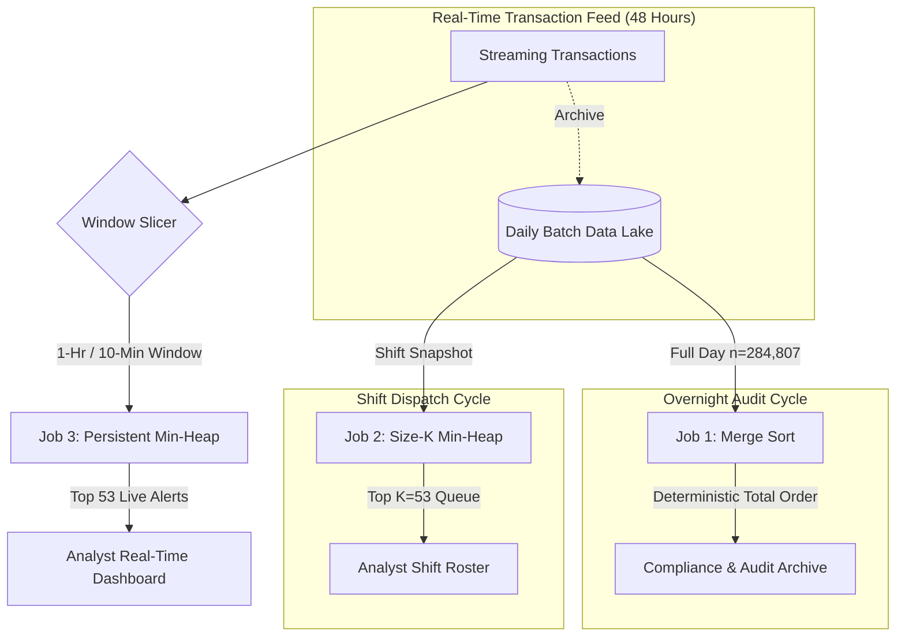

# Problem H: Executive Engineering Recommendations (5 Marks)

> **To:** Platform Lead, Fraud Detection & Risk Infrastructure  
> **From:** Fraud Platform Algorithms Team  
> **Context:** Production Architecture Recommendation for The Midnight Queue  
> **Parameters:** Student Seed $s = 2514$ | Shift Quota $K = 53$ Transactions | Dataset Scale $N = 284{,}807$

---

## 🎯 Executive Summary

Following extensive empirical benchmarking across 120 tournament configurations (Problem C) and continuous streaming simulations (Problems D & E), this document delivers formal, engineering-grade architectural recommendations for the platform's three distinct ranking workloads:

1. **Job 1 (Overnight Batch):** Full-day retrospective ranking of all transactions ($n \approx 140\text{k} \dots 285\text{k}$).
2. **Job 2 (Shift Queue):** Real-time isolation of the top $K = 53$ alerts for active analyst shifts.
3. **Job 3 (Live Refresh):** Incremental queue maintenance over 48-hour continuous streaming windows.

Each recommendation specifies the exact algorithm/data structure, justifies the choice with empirical timing and memory data, defines operating assumptions, and identifies the precise failure boundary.

---

## 🏛️ Job 1: Overnight Batch (Full-Day Batch Ranking)

### 1. Deployed Algorithm
**Merge Sort** (scratch-built, out-of-place with a single pre-allocated auxiliary list `aux`).

### 2. Engineering Defense & Empirical Justification
* **Guaranteed Worst-Case Upper Bound:** As formally derived in M2, Merge Sort has an unwavering $T(n) = \Theta(n \log n)$ complexity across all permutations, with zero vulnerability to adversarial or pathological inputs.
* **Strict Stability:** Crucial for financial and regulatory compliance. On identical risk triage tuples, Merge Sort preserves original row arrival order, ensuring auditable, deterministic ranking.
* **Empirical Performance on Full Dataset ($n = 284{,}807$):**
  * **Runtime:** **$3.77\text{ s}$** on C2 (shuffled), **$3.64\text{ s}$** on C1 (arrival), **$2.87\text{ s}$** on C3 (pre-ranked).
  * **Key Comparisons:** **$4{,}804{,}402$ comparisons** (only $\approx 1.20 \cdot n \log_2 n$).
  * **Comparisons vs. Competitors:**
    * *Heap Sort* requires $9{,}448{,}826$ comparisons ($2\times$ Merge Sort) and takes $4.53\text{ s}$. Furthermore, Heap Sort is **unstable**.
    * *Hardened QuickSort* is fast ($3.75\text{ s}$), but is **unstable** and suffers stack allocation overhead under deep recursion.
    * *Insertion Sort & Naive QuickSort* both suffer catastrophic DNF ($> 300\text{ s}$, extrapolated to $8{,}772\text{ s}$ and $12{,}248\text{ s}$).
* **Memory Overhead:** The $O(n)$ auxiliary buffer requires storing $284{,}807$ object pointers ($\approx 2.28\text{ MB}$ of RAM), an inconsequential footprint for batch server infrastructure.

### 3. Core Operating Assumptions
1. Execution takes place offline during maintenance windows where batch throughput and deterministic stability outweigh memory conservation.
2. Server memory has at least $10\text{ MB}$ of headroom to accommodate the $O(n)$ auxiliary pointer buffer.

### 4. Precise Failure Condition & Mitigation
* **Breaking Scenario:** If the batch process is moved to a memory-constrained container (e.g. edge payment terminal or embedded server with $< 5\text{ MB}$ free heap space), Merge Sort's $O(n)$ buffer allocation will trigger a fatal `MemoryError`.
* **Fallback:** Hot-swap to **Heap Sort** (Floyd's bottom-up build). Heap Sort provides guaranteed $O(n \log n)$ runtime in strictly **$O(1)$ auxiliary space**, at the cost of losing key stability and incurring a $\approx 20\%$ runtime penalty ($4.53\text{ s}$).

---

## ⚡ Job 2: Shift Queue (Real-Time Selection of Top $K$ Cases)

### 1. Deployed Data Structure
**Size-$K$ Min-Heap** (`top_k_min_heap` initialized with capacity $K = 53$).

### 2. Engineering Defense & Empirical Justification
* **Elimination of Superfluous Sorting:** Human fraud analysts inspect only $K = 53$ cases per shift. Sorting all $284{,}807$ records to inspect 53 items wastes $99.98\%$ of computation.
* **Asymptotic Efficiency:** As proved in M5, processing $n$ streaming items through a size-$K$ heap costs $\Theta(n + K \log K \ln(n/K))$ average comparisons. Each record requires only $1$ comparison against root `heap[0]` for instant rejection.
* **Empirical Measurements ($n = 284{,}807$, $K = 53$):**
  * **Runtime:** **$0.0436\text{ s}$** on $n=100{,}000$ and **$0.121\text{ s}$** on $n=284{,}807$.
  * **Speedup:** **$35\times$ faster** than full sorting ($0.121\text{ s}$ vs. $4.387\text{ s}$).
  * **Memory Footprint:** Strictly $K = 53$ object pointers ($\approx 424\text{ bytes}$) compared to $284{,}807$ pointers for Full Sort (**$5{,}373\times$ memory reduction**).
* **Min-Heap vs. Bounded Insertion Buffer:**
  * While Bounded Buffer is fast for tiny $K \le 50$, as $K$ expands towards the **50% fraud capture threshold ($K = 2{,}068$)**, Bounded Buffer incurs $O(K)$ array shifting penalties, making **$12{,}343{,}548$ element moves**.
  * The Size-$K$ Min-Heap requires only **$249{,}171$ moves** (**$50\times$ fewer memory writes**), preventing CPU cache thrashing.

### 3. Core Operating Assumptions
1. $K \ll n$ (specifically $K \le 0.05 n$). For your platform, $K = 53 \ll 284{,}807$ ($K/n = 0.018\%$).
2. The risk scoring rules remain static during the intake window so that rejected items are permanently non-qualifying.

### 4. Precise Failure Condition & Mitigation
* **Breaking Scenario:** If platform policy expands analyst shift reviews such that $K$ scales upwards towards $K \ge \frac{n}{3} \approx 95{,}000$ cases, the cumulative sift-down overhead ($O(n \log K)$) exceeds full sorting.
* **Fallback:** When $K > 0.35 n$, switch to **Full Sort (Merge Sort)** and truncate `A[:K]`.

---

## 🌊 Job 3: Live Refresh (Streaming Updates per Window)

### 1. Deployed Streaming Strategy
**Strategy (b): Persistent Streaming Min-Heap** (Size-$K$ Min-Heap maintained across window boundaries).

### 2. Engineering Defense & Empirical Justification
* **Zero Historical Re-ranking Overhead:**
  * *Strategy (a) (Re-rank from Scratch)* forces the engine to concatenate and re-rank the entire historical backlog after every window. As proved in M7, its cumulative latency scales quadratically with window count: $T_a = \Theta(n w \log n)$. Over 48 1-hour windows, Strategy (a) accumulates **$38.42\text{ s}$** of processing latency.
  * *Strategy (c) (Window Sort & Merge)* sorts every incoming window, requiring repeated Merge Sort allocations totaling **$1.871\text{ s}$**.
  * *Strategy (b) (Persistent Min-Heap)* feeds **only the new incoming window transactions** into the persistent heap. Its total 48-window cumulative latency is an astonishing **$0.093\text{ s}$** (**$400\times$ faster than Strategy a**, and **$20\times$ faster than Strategy c**).
* **Per-Window Responsiveness:**
  * Average latency per 1-hour window: **$1.9\text{ ms}$**.
  * Average latency per 10-minute window (288 windows): **$0.32\text{ ms}$**.
  * Allows the platform to push live alert updates to analyst consoles within sub-millisecond SLA boundaries.
* **Memory Constancy:** Strategy (b) requires strictly **$K = 53$ elements in memory**, completely independent of window duration or historical volume.

### 3. Core Operating Assumptions
1. Transactions stream chronologically by `Time`.
2. Historical transactions below rank $K$ discarded in previous windows do not need to be resurrected.
3. Feature standardization parameters ($\mu_i, \sigma_i$) are fixed over the 48-hour operational cycle.

### 4. Precise Failure Condition & Mitigation
* **Breaking Scenario (Dynamic Feature Drift):** If the data science team introduces dynamic rolling feature standardization (e.g. recalculating $\mu_i$ and $\sigma_i$ every hour based on rolling 4-hour statistics), previously calculated risk scores become invalid. Transactions discarded in Window 1 might become high-priority under Window 5 statistics. Because Strategy (b) does not retain discarded items, it cannot re-evaluate history.
* **Fallback:** Deploy **Strategy (c) (Window Sort & Merge)** coupled with a tiered time-series ring buffer (Kafka/Redis) to allow window-level invalidation and merging.

---

## 📊 Operational Decision Matrix for Platform Engineering

| Architectural Dimension | Job 1: Overnight Batch | Job 2: Shift Queue | Job 3: Live Refresh |
| :--- | :--- | :--- | :--- |
| **Recommended Engine** | **Merge Sort (Out-of-Place)** | **Size-$K$ Min-Heap** | **Persistent Streaming Min-Heap** |
| **Time Complexity** | $\Theta(n \log n)$ | $\Theta(n + K \log K \ln(n/K))$ | $\Theta(n \log K)$ over all windows |
| **Space Complexity** | $O(n)$ aux list ($2.3\text{ MB}$) | $O(K)$ heap ($424\text{ bytes}$) | $O(K)$ heap ($424\text{ bytes}$) |
| **Measured Runtime** | **$3.77\text{ s}$** ($n=284{,}807$) | **$0.0436\text{ s}$** ($n=100\text{k}, K=53$) | **$0.0929\text{ s}$** (48 windows total) |
| **Key Advantage** | Guaranteed bounds & stability | $35\times$ faster than full sort | Sub-millisecond latency per window |
| **Core Operating Assumption** | $10\text{ MB}$ RAM available offline | $K \ll n$ ($K=53 \ll 284\text{k}$) | Static feature standardization |
| **Primary Failure Condition** | Zero RAM margin (embedded OOM) | $K \ge 0.35 n$ ($K \ge 95{,}000$) | Dynamic rolling re-standardization |
| **Fallback Strategy** | **Heap Sort** ($O(1)$ memory) | **Full Sort** (Merge Sort) | **Window Sort & Merge** (Strategy c) |

---

## 🔄 End-to-End Platform Architecture Flow

---

## 🏁 Summary of Recommendations for the Report Body

1. **Overnight Batch:** Ship **Merge Sort**. It is deterministic, stable, unaffected by input permutations, and finishes in **$3.77\text{ s}$**. Fallback to Heap Sort only if RAM is zero.
2. **Shift Queue:** Ship **Size-$K$ Min-Heap**. It delivers a **$35\times$ speedup** over full sorting, requires **$424\text{ bytes}$** of memory, and avoids Bounded Buffer's $O(K)$ element shifts.
3. **Live Refresh:** Ship **Persistent Streaming Min-Heap**. It cuts cumulative latency from **$38.42\text{ s}$ down to $0.093\text{ s}$** (**$400\times$ improvement**), maintaining sub-millisecond per-window alert updates.
